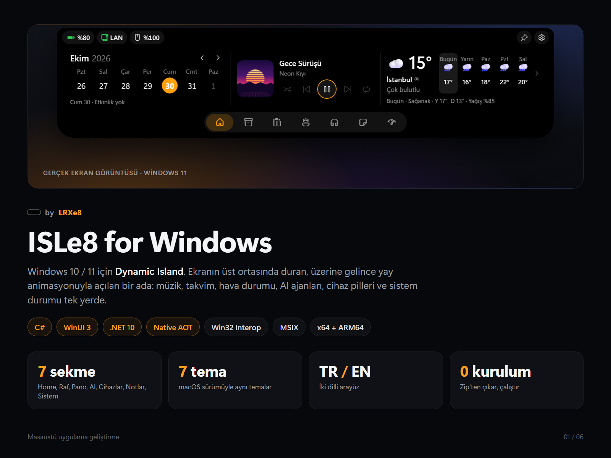
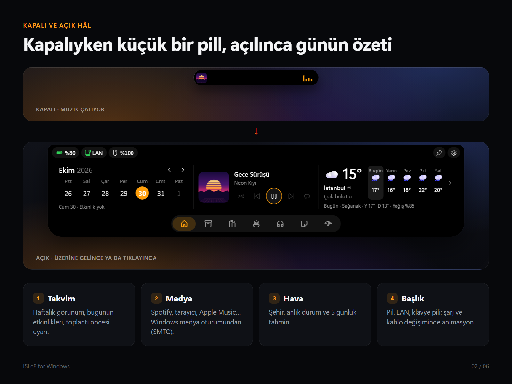
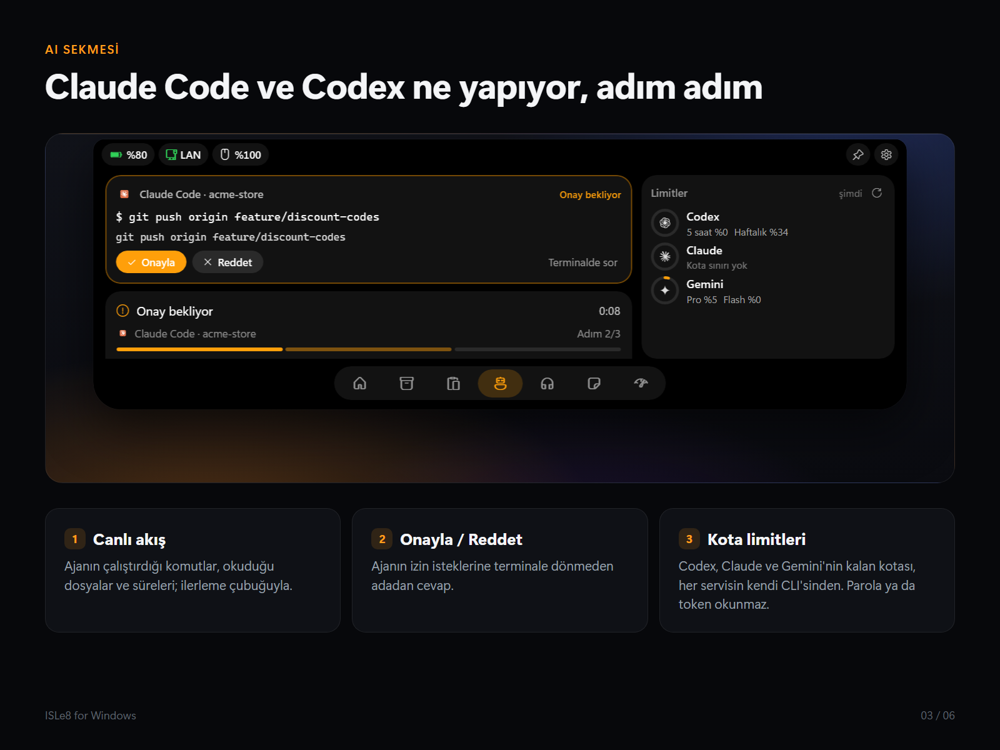
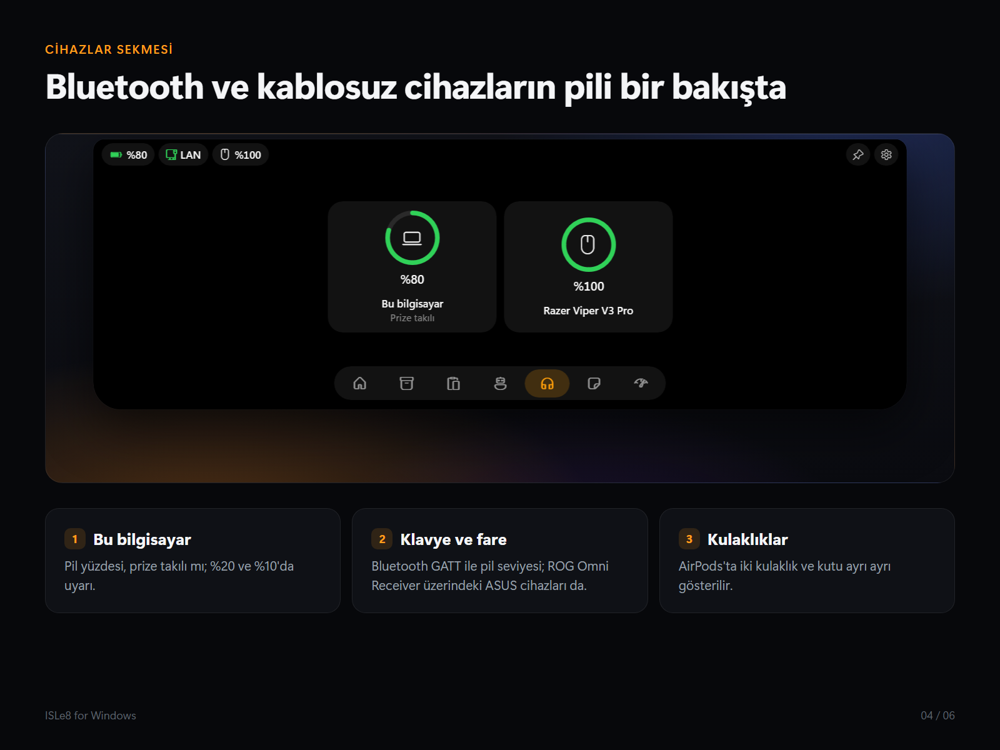
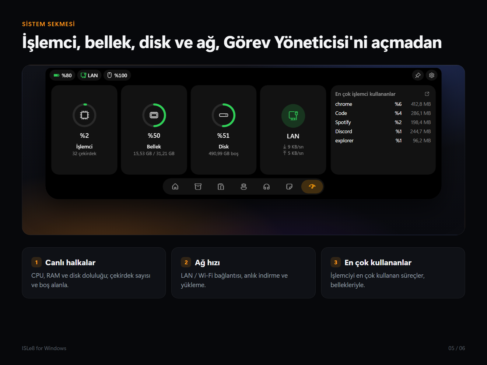

# ISLe8 for Windows

by **LRXe8**. Windows 10 / 11 için Dynamic Island: ekranın üst ortasında duran, üzerine gelince yay animasyonuyla açılan
bir ada. Müzik, takvim, hava durumu, AI ajanları, cihaz pilleri ve sistem durumu tek yerde. macOS'taki ISLe8'in Windows
sürümü; C# + WinUI 3, .NET 10, Native AOT, x64 ve ARM64.



<table>
  <tr>
    <td></td>
    <td></td>
  </tr>
  <tr>
    <td></td>
    <td></td>
  </tr>
</table>

## Özellikler

- **Home:** takvim, çalan şarkı (Spotify, tarayıcı, Apple Music…, Windows'un medya oturumundan), hava durumu, zamanlayıcı.
- **AI:** Claude Code ve Codex'in ne yaptığı, adım adım; izin isteklerine adadan Onayla / Reddet. Codex, Claude ve
  Antigravity'nin kalan kotası her servisin kendi CLI'sinden okunur; parola ya da token okunmaz.
- **Cihazlar:** bu bilgisayarın ve Bluetooth cihazlarının pili (AirPods'ta iki kulaklık ve kutu ayrı); Razer,
  SteelSeries Arctis Nova Pro Omni ve Arctis 7+ / 7P+ / 7X+, ASUS ROG Omni Receiver alıcılarındaki cihazlar da.
- **Sistem:** işlemci, bellek, disk, ağ hızı ve en çok işlemci kullanan süreçler.
- **Oyunlar:** Windows'un tanıdığı bir oyun öndeyken ada hareketsiz kalır ya da gizlenir; istersen küçük adada FPS, CPU ve
  GPU kullanımı ve sıcaklıkları.
- **Raf, Pano, Notlar:** sürüklenen dosyalar, pano geçmişi, notlar (Shift+Enter yeni satır).
- **Uyarılar:** şarj, Ethernet kablosu ve düşük pil; ses ve parlaklık göstergesi (isteğe bağlı, Windows'unkinin yerine).
- **Kişiselleştirme:** Mac'tekiyle aynı 7 tema; ada ekranın üstünde ya da görev çubuğunun üstünde solda, ortada, sağda;
  kapalıyken siyah, temaya uyan ya da saydam; boştayken ince çubuk, saat, çalan şarkının adı; tam ekranda gizlenme.
  Türkçe / İngilizce.

## İndir ve çalıştır

1. [Releases](https://github.com/Mericsdc/ISLe8-Windows/releases/latest) sayfasından zip'i indir: çoğu bilgisayar için
   **win-x64**, Snapdragon / ARM için **win-arm64**.
2. Bir klasöre çıkar ve **ISLe8.exe**'yi çalıştır. Kurulum ya da .NET gerekmez.
3. Windows "bilgisayarınızı korudu" derse: **Ek bilgi › Yine de çalıştır** (uygulama henüz imzalı değil).

Gereken: Windows 10 2004+ ya da Windows 11.

**Bildirim aynası için kurulu sürüm:** Windows başka uygulamaların bildirimlerini yalnızca kurulu (paketli) uygulamalara
okutur. Zip'ten açılan ISLe8'de **Ayarlar › Bildirimler › Kurulu sürüme geç**: paket henüz imzasız olduğundan önce
Windows Ayarları › Sistem › Geliştiriciler için › **Geliştirici Modu**'nu açman gerekir. Sonra **Kur ve geç**; ayarlar kalır.

**Güncelleme:** ISLe8 yeni sürümü günde bir kez GitHub'a sorar. **Ayarlar › Genel › Güncellemeler**'de ya da bildirim
alanı simgesinin menüsünde **Güncelle**: indirir, SHA-256'sını denetler, kendini değiştirip yeniden açılır; ayarlar kalır.
0.2.7 ve öncesinden güncellerken ISLe8 kapanıp eski sürüm geri açılabiliyor (0.2.8'de düzeldi): o sürümlerden bir kez
yeni zip'i elle indirip eski klasörün yerine koy. Uygulama henüz imzalı olmadığından Microsoft Defender 0.2.7'yi yanlışlıkla
"Trojan:Win32/Bearfoos.A!ml" diye siliyor; 0.2.7'yi kullanma, 0.2.8'i indir.

### Kullanım

- Pill'in üstünde imleci bir an tut ya da tıkla: ada açılır; imleç çıkınca ya da başka yere tıklayınca kapanır.
- Sağ tık: **Açık tut**, **Ayarlar…**, **Tema**, **Ekran**, **Dil**, **ISLe8'den çık**. Bildirim alanındaki simge de
  Ayarlar'ı açar.
- Girişte başlatmak için: **Ayarlar › Genel › Girişte başlat**.
- Komut satırı: `isle8 open agents`, `isle8 activity start --id derleme --title "Derleme" --progress 0.4` (zip'te
  klasördeki `isle8-cli.exe`).

### Günlük ve ayarlar

Bir şey ters giderse günlük dosyası burada (yalnızca hata ve yaşam döngüsü satırları; şarkı adı,
pano ya da bildirim içeriği yazılmaz):

- Zip'ten ya da `scripts\run.ps1` ile: `%LOCALAPPDATA%\LRXe8\ISLe8\isle8.log`
- Paketli (MSIX) sürüm de aynı klasörü kullanır; paketin sanallaştırması kapalı.

Ayarlar aynı klasörde `settings.json`.

---

## Geliştirme

### Gerekenler

- [.NET 10 SDK](https://dotnet.microsoft.com/download/dotnet/10.0): `winget install Microsoft.DotNet.SDK.10`.
  Yalnızca .NET 6/8 kuruluysa derleme açılmaz; `global.json` bunu açıkça söyler.
- Native AOT yayını için: Visual Studio 2026 ya da Build Tools, **"C++ ile masaüstü geliştirme"**
  bileşeniyle (MSVC bağlayıcısı). Yoksa `-NoAot` kullan ya da yayını GitHub Actions'a bırak.
- İsteğe bağlı: Visual Studio 2026, **"WinUI uygulama geliştirme"** iş yüküyle (VS 2022 .NET 10'u açmaz).

### Çalıştırma

Visual Studio gerekmez. PowerShell'de, depo klasöründe:

```powershell
powershell -ExecutionPolicy Bypass -File scripts\run.ps1
```

Visual Studio ile (paketli, MSIX): `ISLe8.slnx`'i aç, platformu `x64` (ARM64 bilgisayarda `ARM64`) seç,
profil **ISLe8 (Package)** › F5. Bildirim aynası ve "Girişte başlat"ın başlangıç görevi paket kimliği ister.

### Paketli kurulum (bildirim aynası için)

Windows Ayarları › Sistem › Geliştiriciler için › **Geliştirici Modu**'nu aç, sonra:

```powershell
powershell -ExecutionPolicy Bypass -File scripts\install.ps1
```

Derler, `artifacts\package-win-x64`'e yayınlar ve oradan kaydeder (C++ araçları yoksa `-NoAot`). ISLe8 Başlat
menüsünde görünür; o klasörü silme. Kaldırmak: `Get-AppxPackage com.lrxe8.isle8 | Remove-AppxPackage`. Ayarlar ve
geçmiş zip sürümüyle aynı klasörde kalır. Bildirimler: **Ayarlar › Bildirimler**; Gmail gibi siteler tarayıcının
bildirimleriyle gelir.

### Yayın (zip)

```powershell
powershell -ExecutionPolicy Bypass -File scripts\publish.ps1
```

`artifacts\ISLe8-<sürüm>-win-x64.zip` üretir; Releases'teki dosyanın aynısı. `scripts\package.ps1` kurulu ISLe8'in
güncelleme dosyasını (`ISLe8-<sürüm>-win-x64-package.zip`: paket klasörü, AppxManifest.xml'iyle) üretir. `-Platform ARM64` ARM için,
`-NoAot` C++ araçları olmayan bir bilgisayarda (JIT, kendi .NET'iyle; ~65 MB).

### Sürüm yayınlama

1. `Directory.Build.props` › `Version` ve `src/ISLe8.App/Package.appxmanifest` › `Version`'ı artır.
2. Etiketle ve gönder:

```powershell
git tag v0.1.0
git push origin v0.1.0
```

`.github/workflows/release.yml` testleri çalıştırır, x64 ve ARM64 için Native AOT ile derler; zip'leri ve paket
zip'lerini o etiketin GitHub Release'ine koyar. Uygulamadaki Güncelle düğmesi bunları "latest" sürümden alır; taslak
ve ön sürümler güncelleme sayılmaz. `windows.yml` yalnızca elle çalışan bir derleme denetimi; ikisi de
her push'ta çalışmaz, çünkü özel repolarda Windows dakikaları iki kat sayılır.

### Ölçüm

Gerçek sayılar için Release + Native AOT yayınını kullan (Debug JIT ile çalışır ve daha ağırdır).
ISLe8 açıldıktan en az 30 sn sonra, ada kapalıyken, fareye dokunmadan:

```powershell
powershell -ExecutionPolicy Bypass -File scripts\measure.ps1 -Seconds 60
```

Müzik çalarken: `-Label muzik`. Hedefler DESIGN.md › Performans bütçesi'nde (boşta CPU < %0,1,
bellek < 80 MB). Bir tarayıcı sekmesi arka planda çalıyor olabilir; "boşta" ölçümünden önce ve sonra
medya durumunu kaydet:

```powershell
powershell -ExecutionPolicy Bypass -File scripts\media-state.ps1
```

### MSIX imzalama (ileride, W6)

Paket, `Package.appxmanifest`'teki yayıncıyla (`CN=LRXe8`) aynı konulu bir sertifikayla imzalanmalı.
Kendi bilgisayarın için kendinden imzalı bir sertifika yeterli (PowerShell, yönetici):

```powershell
New-SelfSignedCertificate -Type Custom -Subject "CN=LRXe8" -KeyUsage DigitalSignature -FriendlyName "ISLe8 dev" -CertStoreLocation "Cert:\CurrentUser\My" -TextExtension @("2.5.29.37={text}1.3.6.1.5.5.7.3.3", "2.5.29.19={text}")
```

Sertifikayı "Güvenilen Kişiler" deposuna da ekledikten sonra Visual Studio › Paketle ve Yayımla ›
Uygulama Paketleri Oluştur ile paket üretilir. Ayrıntılar W6'da.

### Mac'te denetim

Uygulama Mac'te çalışmaz, ama Core testleri ve uygulamanın bütün C# kodunun gerçek WinUI/Windows
API'lerine karşı derlenmesi Mac'te de denetlenebilir (PRI, MSIX ve Native AOT yalnızca Windows'ta):

```bash
brew install --cask dotnet-sdk
```

```bash
scripts/check-on-mac.sh
```

---

## macOS sürümüyle ilişki

Aynı ürün, ayrı kod. Mac sürümü Swift/SwiftUI, bu sürüm C#/WinUI; ortak kod satırı yok, çünkü işin
çoğu platformun kendi API'si (MediaRemote ↔ SMTC, notch ↔ pill, EventKit ↔ AppointmentStore).
Ortak olan sözleşme: aynı 7 tema ve aynı tema JSON'u (Mac'te dışa aktarılan tema burada açılır), aynı
yay değerleri, aynı Türkçe/İngilizce metinler, aynı faz adları. Birinde bunlardan biri değişince
diğerine de taşınır.

Mac'teki sistemlerin buraya nasıl taşınacağı, modül modül Mac kaynak dosyaları, davranış ayrıntıları,
eksikler ve kabul kriterleriyle [PORTING.md](PORTING.md)'de.

---

## Klasörler

```
src/ISLe8.Core         platformdan bağımsız: yerleşim/DPI, yaylar, temalar, ayarlar, medya modeli, günlük
src/ISLe8.App          WinUI 3 uygulaması (XAML dosyası yok)
  Shell/               pencere, saydamlık, monitörler, tam ekran
  Island/              ada denetleyicisi, görünüm, Composition yüzeyi
  Media/               SMTC servisi, oynatıcı, ses çubukları
  Interop/             Win32 çağrıları (LibraryImport, AOT uyumlu)
  Strings/             tr-TR ve en-US .resw
tests/ISLe8.Core.Tests xUnit; Mac'te de çalışır
scripts/               run.ps1, publish.ps1, measure.ps1, check-on-mac.sh, make-assets.swift
.github/workflows/     release.yml (etiketle yayın), windows.yml (elle derleme denetimi)
```

---

## Lisans

Kod [Apache License 2.0](LICENSE) ile lisanslı. **ISLe8** ve **LRXe8** adları, logoları ve uygulama simgesi bu lisansa dahil değil; bir çatal dağıtacaksan kendi adını ve simgesini kullan ([TRADEMARKS.md](TRADEMARKS.md)). Telif ve üçüncü taraf bildirimleri [NOTICE](NOTICE) dosyasında.

Windows, Microsoft Corporation'ın; Apple ve Dynamic Island, Apple Inc.'in markalarıdır. ISLe8 bağımsız bir projedir.
